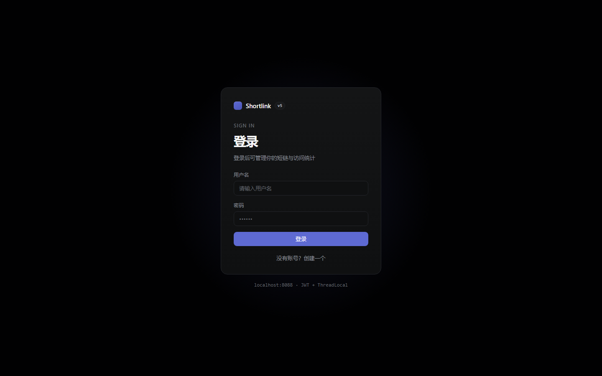
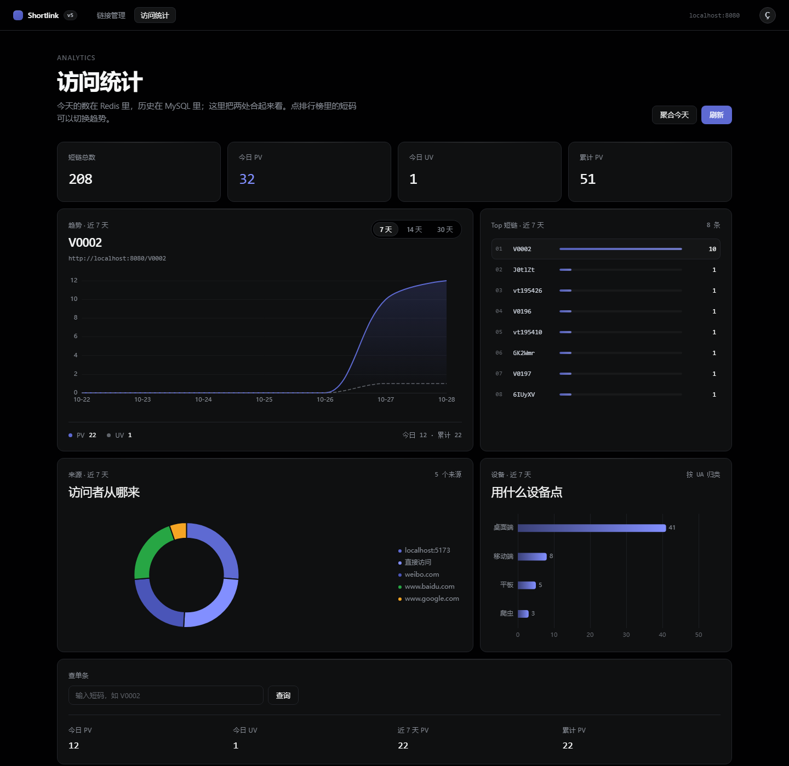
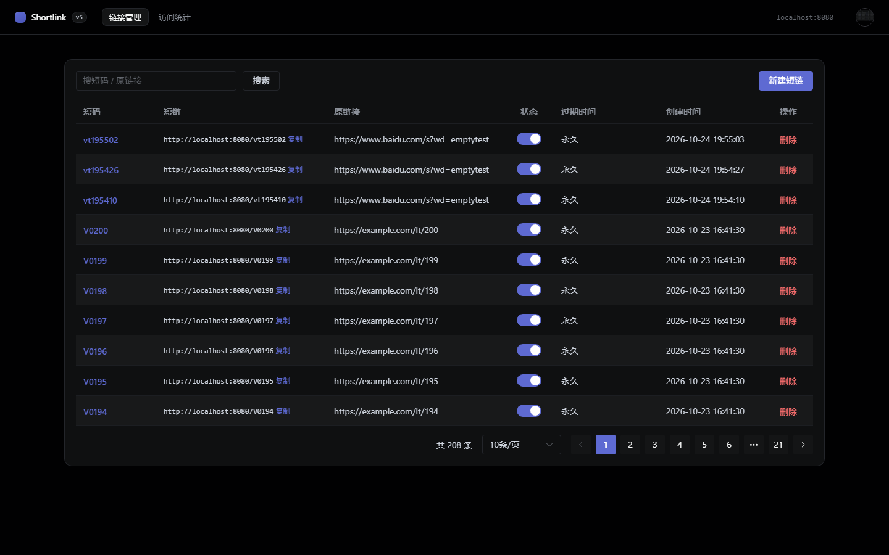

# ShortLink · 短链接服务

一个从零实现的全栈短链接服务：长链接转短链、302 跳转、访问统计、管理后台。

| 层 | 技术 |
|---|---|
| 后端 | JDK 17 · Spring Boot 3.3 · MyBatis-Plus · MySQL 8 · Redis 7 |
| 前端 | Vue 3 · Vite · Element Plus · Axios（ECharts 留给统计页） |
| 部署 | Docker Compose（nginx + Spring Boot + MySQL + Redis，一条命令起全套） |
| 压测 | JMeter |

## 目录结构

```
shortlink/
├── Dockerfile               # 后端两阶段构建（maven 编译 → JRE 运行）
├── docker-compose.yml       # 四个服务：mysql / redis / backend / frontend
├── docs/
│   ├── 需求文档.md          # 这个项目做什么、为什么这么做
│   ├── 路线图.md            # 六周可打勾计划
│   ├── 部署.md              # 部署架构、nginx 规则、常见问题
│   └── openapi.yaml         # 前后端接口契约（给 AI 生成前端用）
├── sql/
│   ├── 01-schema.sql        # 建库建表（short_link / access_log / link_stats）
│   ├── 02-user.sql          # 用户表 + 默认账号 admin / 123456
│   ├── migrations/          # 老库增量迁移（新装不用管）
│   └── 02-user.sql          # 用户表 + 默认管理员
├── src/main/java/com/dafeiyu/shortlink/
│   ├── ShortLinkApplication.java
│   ├── common/              # 统一返回、异常、全局处理、UserContext
│   ├── config/              # MyBatis-Plus、跨域、JWT、鉴权/限流拦截器
│   ├── controller/          # 接口
│   ├── dto/                 # 入参/出参
│   ├── entity/              # 数据库实体
│   ├── mapper/              # 数据访问
│   ├── service/             # 业务逻辑（含采集器、聚合、限流、布隆）
│   └── util/                # Base62、URL 校验、JWT
├── src/main/resources/
│   ├── application.yml
│   └── lua/token_bucket.lua # 令牌桶脚本
├── frontend/                # Vue 3 管理台（Vite + Element Plus）
│   ├── Dockerfile           # 前端两阶段构建（node 打包 → nginx 托管）
│   ├── nginx.conf           # 静态托管 + /api、/uploads、短码跳转反代
│   ├── src/api/             # 接口封装，统一拆 {code,message,data}
│   ├── src/views/           # 列表页、统计页、登录页
│   └── src/components/      # 弹窗、图表、用户菜单
├── loadtest/                # JMeter 压测计划 + 脚本
└── pom.xml
```

## 快速开始

### 0. 先搞清楚数据库跑在哪

你本机 3306 端口已经有一个 MySQL 服务在跑，**项目默认连的是 3307**，两者不冲突。

**方案 A：用 Docker（推荐，一次装好，六周都用它）**

```bash
docker compose up -d
```

MySQL 会在 `localhost:3307`，Redis 在 `localhost:6379`，建表脚本会自动执行。
装 Docker 的步骤见 [docs/装Docker.md](docs/装Docker.md)。

**方案 B：用你本机已有的 MySQL（3306）**

改 [application.yml](src/main/resources/application.yml) 两行：url 里的 `3307` 改成 `3306`，`password` 改成你的 root 密码。然后手动建表：

```bash
mysql -uroot -p < sql/01-schema.sql
```

### 1. 启动

```bash
mvn spring-boot:run
```

### 2. 试一下

```bash
curl -X POST http://localhost:8080/api/links -H "Content-Type: application/json" -d '{"originUrl":"https://www.baidu.com/s?wd=shortlink"}'
```

（Windows cmd 里把行尾的 `'` 换成 `"`，或者直接用 Postman / IDEA 的 HTTP Client。）

返回：

```json
{"code":200,"message":"success","data":{"code":"aB3xK9","shortUrl":"http://localhost:8080/aB3xK9","originUrl":"https://www.baidu.com/s?wd=shortlink","expireTime":null}}
```

浏览器打开 `http://localhost:8080/aB3xK9`，应该 302 跳回百度。

### 3. 前端管理台

```bash
cd frontend
npm install     # 只需第一次
npm run dev
```

打开 <http://localhost:5173> 就是管理台：列表、搜索、分页、新建、启用/停用、删除，全部走真实接口。

- 前端把 `/api` 通过 Vite 的 proxy 转给 `localhost:8080`，**不用管跨域**，但**后端必须同时开着**。
- 改一行代码，页面自动刷新，比在 Apifox 里手填 JSON 快得多。Apifox 留着干两件事：调还没做界面的接口、造特殊数据（比如故意传 3 位短码看 400）。
- 如果 `npm run dev` 或 `npm run build` 报 `Access is denied`（esbuild 删临时文件失败），把临时目录指到工作区：

  ```bash
  mkdir -p D:\dafeiyuwork\.tmp
  export TEMP='D:\dafeiyuwork\.tmp'
  ```

### 4. 登录

管理台现在要登录才能用（默认账号 **admin / 123456**，仅本机演示用）。第一次启动前先建表：

```bash
docker exec -i shortlink-mysql mysql -uroot -p123456 shortlink < sql/02-user.sql
```

> ⚠️ **只要打算放到公网，先去右上角头像 → 修改密码，把 `123456` 换掉。** 默认密码写在仓库里，不改等于把管理员权限公开。

鉴权链路（面试可以直接照着讲）：

| 环节 | 实现 | 为什么这么做 |
|---|---|---|
| 密码存储 | `MD5(salt + 明文)`，每个用户独立随机盐 | 同样密码不同用户 hash 不同，防彩虹表 |
| 登录凭证 | 用 `HmacSHA256` 手写的 JWT（`util/JwtUtil.java`） | 就是两段 base64 + 一次签名，看懂比调库值钱 |
| 校验 | `AuthInterceptor` 拦 `/api/**`，验签 + 验过期 | 只拦接口；`/{code}` 跳转必须能匿名访问 |
| 传递用户 | `ThreadLocal`（`common/UserContext.java`） | 拦截器 set、业务 get、`afterCompletion` remove |
| 退出 | token 的 `jti` 写进 Redis 黑名单，TTL = 剩余寿命 | JWT 无状态，不拉黑就退不干净 |
| 登录失败 | 用户不存在和密码错误返回**同一句话** | 防止撞库的人枚举用户名 |
| 头像 | 存 `./uploads/avatar/`，映射成 `/uploads/**` | 文件名由服务端生成，避免路径穿越和覆盖 |

接口：`POST /api/auth/register`、`/login`、`/logout`、`/password`、`/avatar`，`GET /api/auth/me`。

### 5. 限流与安全

| 风险 | 实现 | 关键点 |
|---|---|---|
| 接口被刷 | 令牌桶（Redis + Lua），四个桶 | 「读-算-写」必须在同一个 Lua 里，否则并发扣票会超卖 |
| 超限体验 | 429 + `Retry-After` / `X-RateLimit-Remaining` | 快速失败，不让请求排队（Tomcat 200 线程会被占满） |
| 刷建链接口 | `create` 桶（容量 10 / 每秒 0.5） | 建链是唯一写库的接口，单独收紧 |
| 密码爆破 | `auth` 桶（容量 5 / 每秒 0.2） | 按 IP 限；登录/注册不在鉴权排除之外 |
| 开放重定向 / SSRF | `util/UrlValidator.java` | 协议白名单、`user:pass@` 写法、内网/回环/CGNAT/云元数据地址、非 80/443 端口 |
| 短码枚举 | `service/MissGuard.java` | 每分钟 404 超 30 次 → 429；只对 404 计数，410（停用/过期）不算猜错 |

阈值都在 [application.yml](src/main/resources/application.yml) 的 `shortlink.rate-limit` 下。

## 一条命令起全套

```bash
docker compose up -d --build
```

启动完访问 <http://localhost:8088>，四个容器（mysql / redis / backend / frontend）全部 `healthy`。
首次构建要拉镜像 + 下 Maven 依赖，**10~45 分钟取决于网络**（依赖下载是大头）；之后改代码重建只要 1~2 分钟。
架构、nginx 为什么要把短码路由单独拎出来、镜像怎么从 700MB 瘦到 429MB、构建卡住怎么排查，见 [docs/部署.md](docs/部署.md)。

## 界面

登录页（JWT 鉴权，左上角是品牌标，强调色只出现在主按钮）：



访问统计页（Linear 设计语言：深色底 + 近黑面板 + 细描边 + 单一强调色，强调色只用在品牌标、主按钮和数据上）；含 PV/UV 趋势、Top 榜、来源饼图、设备柱状图：



短链管理页：



> 页面的视觉规范写在 `frontend/src/styles.css` 顶部的设计变量里，改配色只改那一段。

## 当前进度

- [x] v1 后端骨架：生成 / 跳转 / 列表 / 停用 / 删除
- [x] v2-1 Redis 缓存（QPS 7,088 → 17,701，p99 37 → 10 ms）
- [x] v2-2 空值缓存 + 随机 TTL + 本地布隆过滤器（穿透 QPS 6,713 → 18,781）
- [x] v3 访问统计：有界队列采集 → `access_log` → Redis PV/UV → 每日聚合进 `link_stats` → 查询接口
- [x] v4 前端：短链管理 + 访问统计看板（趋势折线 / Top 榜 / 单码查询）
- [x] v4-2 来源饼图（referer 拆域名）、设备柱状图（UA 归类）、登录页
- [x] v5-1 登录鉴权：注册 / 登录 / 退出（Redis 黑名单）/ 改密码 / 上传头像
- [x] v5-2 令牌桶限流（Redis + Lua，四个桶）+ URL 黑名单 + 枚举防护
- [x] v6 Docker 部署：两阶段镜像 + nginx 单入口 + 健康检查，`docker compose up -d --build` 一条命令起全套
- [x] v6 压测：500 并发 15,688 QPS / p99 62ms；发现并修复 nginx upstream 未开 keepalive（6,237 → 15,688）
- [x] 文档：`docs/架构图.md`（架构/时序/ER，Mermaid）、`docs/简历-项目描述.md`（4 条 bullet + 12 个追问）
- [x] v7 权限：短链归属（`user_id`）+ 管理员 `is_admin`；列表/改/删/详情/统计全部按用户隔离，越权返回 404

## 文档地图

| 文档 | 讲什么 |
|---|---|
| [docs/需求文档.md](docs/需求文档.md) | 做什么、为什么这么做 |
| [docs/路线图.md](docs/路线图.md) | 六周的周计划与打勾进度 |
| [docs/部署.md](docs/部署.md) | 部署架构、nginx 规则、镜像瘦身、常见问题 |
| **[docs/压测报告.md](docs/压测报告.md)** | **压测数据全集**：四轮对比、作废数据、面试口径 |
| [docs/踩坑记录.md](docs/踩坑记录.md) | 踩过的坑与怎么爬出来的 |
| [docs/openapi.yaml](docs/openapi.yaml) | 接口契约（Apifox 可直接导入） |
| [loadtest/README.md](loadtest/README.md) | JMeter 怎么跑、基线记录表 |
| [docs/装Docker.md](docs/装Docker.md) | 本机装 Docker 的步骤 |
| [docs/Docker中英对照.md](docs/Docker中英对照.md) | Docker Desktop 界面中英对照 |

详细安排见 [docs/路线图.md](docs/路线图.md)。
