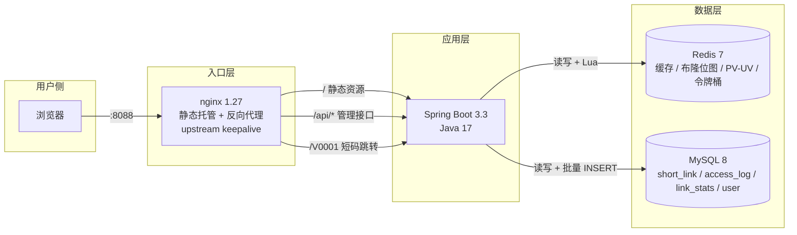
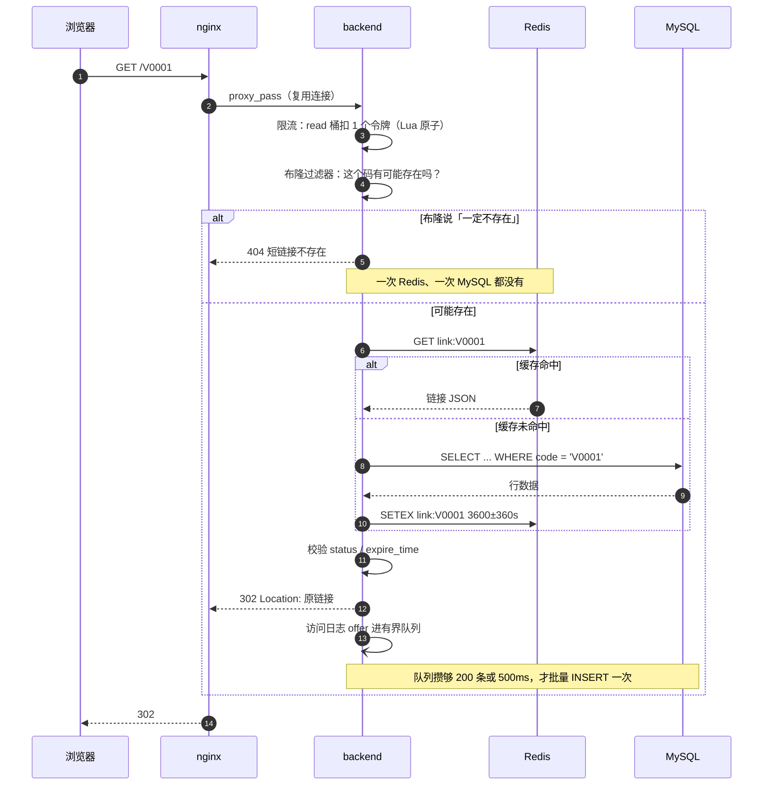
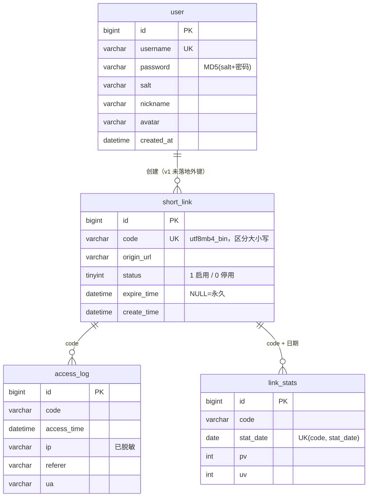

# 架构图

> 用 Mermaid 写，GitHub / Obsidian / VS Code 都能直接渲染，改起来也就是改文本。
> （draw.io 要导入文件，而且改一次就变成二进制谁都看不懂 diff。）

## 一、整体架构

**三个请求方向，三条不同的规则**：

| 入口 | 去哪 | 为什么单独一条 |
|---|---|---|
| `/` | nginx 静态文件 | 前端打包产物，不该走后端 |
| `/api/*` | 后端 | 要鉴权 + 限流 |
| `/[A-Za-z0-9]{4,10}` | 后端 | 短码和静态文件会撞（有个文件叫 `/abc1` 就完了），必须放在 `try_files` 前面 |

## 二、一次跳转发生了什么（核心链路）

## 三、数据模型

**关于 `uk_code` 的排序规则**：`utf8mb4_bin` 而不是默认的 `utf8mb4_general_ci`。
用 `ci`（不区分大小写）的话，`aB3x` 和 `Ab3x` 会被唯一索引判成同一个，短码就冲突了。

## 四、统计数据的流转

- **为什么要队列**：直接同步写库会把跳转拖死（一次 INSERT 几毫秒 × 每秒上万次）。队列 + 批量把 N 次写变成 1 次。
- **为什么 PV 用 Redis、不直接写 MySQL**：跳转路径上一个 MySQL 写都不要有。
- **UV 为什么用 HyperLogLog**：1 亿个 UV 也就 12 KB，误差 0.81%；用 `SET` 存 IP，10 万条就 5 MB。
